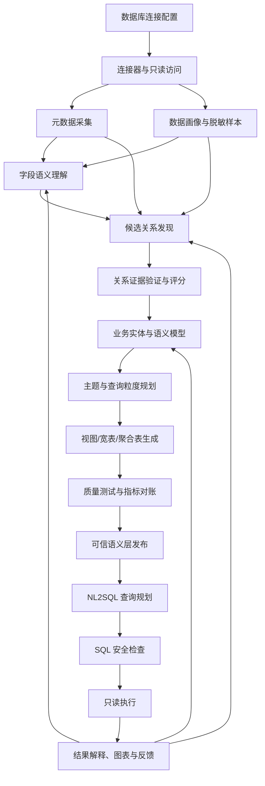

# 企业数据库自动理解、可信业务数据层与 NL2SQL：总路线与里程碑指导手册

- 版本：V1.0
- 用途：作为 Claude Code 编写代码时的项目总指导、任务拆分依据和阶段验收标准。
- 核心目标：配置数据库后，系统尽可能自动完成元数据采集、业务语义推断、跨表关系发现、可信业务视图/宽表生成、NL2SQL 查询及查询型智能体组装。
- 重要原则：先构建可信业务数据空间，再接 NL2SQL；不要把“所有表拼成一张大宽表”当成目标。

---

## 1. 产品目标和边界

### 1.1 最终用户体验

用户在管理界面中：
1. 新建数据源，选择数据库类型并填写连接配置；
2. 选择允许分析的 Schema/表，设置只读和脱敏策略；
3. 启动自动分析任务；
4. 查看表、字段画像和系统发现的候选关系；
5. 查看关系证据、置信等级和可能风险；
6. 对少数有歧义的关系进行确认或拒绝；
7. 选择业务主题并生成视图/宽表；
8. 查看质量检查和对账报告；
9. 使用自然语言提问，获得 SQL、查询结果、图表和解释；
10. 通过反馈持续改进业务语义与查询能力。

### 1.2 第一版不做什么

- 不承诺零人工理解所有行业、所有业务口径；
- 不自动修改源数据库；
- 不默认把所有数据复制进 Elasticsearch；
- 不在未经验证时自动发布关系或业务指标；
- 不首先训练自己的基础大模型；
- 不一开始支持所有数据库、所有权限体系和复杂跨库联邦查询。

### 1.3 成功的定义

系统不仅能生成 SQL，还应当：
- 关系推断有证据、有状态、可回滚；
- 生成数据集具有明确粒度；
- 关键指标通过对账；
- NL2SQL 的结果准确率优于原始 Schema 直接生成基线；
- 能量化减少人工梳理数据关系的时间；
- 任何自动化行为均受权限、审计和查询预算控制。

---

## 2. 总体架构



### 2.1 技术栈建议

首版以 Python 为主，控制依赖数量。

| 模块 | 建议方案 | 说明 |
|---|---|---|
| API 服务 | FastAPI + Pydantic | 连接配置、任务状态、查询 API |
| 数据源接入 | SQLAlchemy + 数据库驱动 | 首先支持 MySQL |
| 元数据存储 | PostgreSQL | 保存扫描快照、关系、语义、版本和审计 |
| 异步任务 | 现有任务队列或 RQ/Celery | 扫描、画像、关系验证等长任务 |
| 字段语义 | LLM Adapter + Embedding Adapter | 支持本地或云端模型，供应商可替换 |
| 关系发现 | Python 规则、统计分析、图搜索 | 可解释、可评测 |
| 数据转换 | SQL 模板/SQLAlchemy；复杂场景可接 dbt | 首版优先生成视图 |
| 数据质量 | 自定义测试 + 可选 Great Expectations | 对账、完整性、重复率等 |
| NL2SQL | 现有 NL2SQL 或开源模型 | 不把模型训练作为第一阶段 |
| 前端 | 轻量管理台 | 展示任务、关系图、证据、数据集和查询结果 |

### 2.2 设计原则

1. **模块化**：连接器、模型、关系算法、SQL 方言均通过接口隔离。
2. **只读优先**：源库只读；生成视图或宽表应在独立目标 Schema/数据库。
3. **证据优先**：保存每个推断的证据、算法版本、置信度与状态。
4. **粒度优先**：每个业务数据集必须定义“一行代表什么”。
5. **失败可见**：任务状态、失败原因、重试次数和日志可查。
6. **可回滚**：关系、语义模型、生成 SQL 和数据集均有版本。
7. **模型可替换**：不要把某个模型厂商 API 写死在业务逻辑中。
8. **逐步自动化**：先允许人工确认，再通过反馈减少人工介入。

---

## 3. 里程碑总览

推荐将项目拆成 M0–M8。每个里程碑均要求先完成可展示的输入输出，再进入下一阶段。各阶段周期只是小团队初步估算，不是交付承诺。

| 里程碑 | 名称 | 主要功能 | 必须展示的输出 | 进入下一阶段的条件 |
|---|---|---|---|---|
| M0 | 工程骨架与评测集 | 项目结构、配置、日志、测试、样例数据和标准问题集 | 可启动服务、README、样例配置、评测集页面/文件 | 本地可一键启动，测试可运行 |
| M1 | 数据库接入与元数据画像 | 测试连接、列举 Schema/表/字段、采集约束与数据画像 | 数据源卡片、Schema 浏览器、表详情、字段画像报告 | 元数据可重复采集，权限与脱敏通过测试 |
| M2 | 字段语义理解 | 表用途分类、字段语义卡片、别名与候选实体 | 字段语义列表、证据、置信等级、人工修订入口 | 输出结构化且不确定时可标记 unknown |
| M3 | 跨表关系发现 | 候选字段对、值域重叠、基数估计、JOIN 验证、关系评分 | 关系候选表/图、证据详情、通过/拒绝/待确认状态 | 在标注集上优于简单基线，错误关系不自动发布 |
| M4 | 业务语义层 | 实体、属性、关系、粒度、指标、查询路径 | 业务主题图、语义模型 JSON/YAML、指标卡片 | 所有已发布对象有来源和状态，指标口径可区分候选与确认 |
| M5 | 数据集/宽表生成 | 主题选择、JOIN 规划、聚合、视图生成、质量校验 | SQL 预览、数据预览、质量报告、发布/回滚操作 | 关键指标对账通过，无未解释的行数膨胀 |
| M6 | NL2SQL 闭环 | 问题解析、语义检索、SQL 生成、安全检查、只读执行、结果解释 | 聊天界面、SQL 展示、结果表、图表、执行日志 | 结果准确率优于原始 Schema 基线，越权查询可拦截 |
| M7 | 查询智能体组装 | 配置工具、权限、上下文、图表、反馈与会话 | 智能体配置页、工具清单、试运行对话 | 所有工具权限受控，行为可审计 |
| M8 | 产品化与持续治理 | 多数据源、任务调度、版本管理、漂移检测、部署 | 运维面板、版本对比、任务重跑、部署说明 | 可恢复、可审计、可升级，核心指标稳定 |

---

## 4. 每个里程碑的统一交付规范

Claude Code 每次只处理一个里程碑或一个明确子任务。每次任务必须包含：

### 4.1 开始前
- 阅读本手册和对应阶段手册；
- 检查现有目录和代码，不要无故重建项目；
- 明确本次范围和不做的事项；
- 提出必要的数据库迁移与依赖变更；
- 先给出计划，再修改文件。

### 4.2 实现中
- 使用类型标注、配置管理和结构化日志；
- 将外部服务调用封装为接口；
- 对关键逻辑写单元测试；
- 对数据库操作、SQL 生成、权限和模型输出写负向测试；
- 不把密钥写入代码、日志或示例；
- 不因测试方便而关闭安全检查。

### 4.3 完成后必须交付
1. 本次变更文件清单；
2. 启动/迁移/测试命令；
3. 自动化测试结果；
4. 可复现的演示步骤；
5. 输入样例与实际输出样例；
6. 已知限制与风险；
7. 验收清单逐项状态；
8. 下一阶段依赖与未解决问题。

禁止只回复“已完成”，必须提供可以运行和核验的结果。

---

## 5. 核心对象与状态约定

### 5.1 关系状态
- `candidate`：刚发现的候选；
- `evidence_collected`：已有静态和数据证据；
- `needs_review`：证据冲突或业务含义不确定；
- `validated`：通过技术验证或授权审核；
- `rejected`：明确拒绝；
- `stale`：源数据或 Schema 变化，需重新验证。

### 5.2 语义状态
- `suggested`：模型建议；
- `data_validated`：技术数据检查通过；
- `business_confirmed`：业务口径已确认；
- `published`：允许用于正式查询。

### 5.3 置信度约定
初期用 `high / medium / low / unknown` 或可解释评分。未经标注集校准，不要将模型自报的分数称为真实概率。

### 5.4 数据集状态
- `draft` → `validating` → `published`
- 校验失败时转为 `failed_validation`
- 源结构变化时转为 `stale`
- 新版本发布后旧版本保留，以便回滚。

---

## 6. 第一版数据流示例

用户配置 MySQL：
- Schema：`power_demo`
- 允许表：`T_DEVICE`、`T_DEFECT`、`T_WORKORDER`
- 只读账号
- 数据样本脱敏

系统输出：
1. `T_DEVICE`：约 10 万行，`DEV_ID` 唯一率 99.9%；
2. `T_DEFECT.OBJ_CODE` 与 `T_DEVICE.DEV_ID`：候选关联，值域覆盖率 87%；
3. `T_WORKORDER.DEV_CODE` 与 `T_DEVICE.DEV_ID`：候选关联，值域覆盖率 93%；
4. 关系详情显示样本证据、基数估计与潜在风险；
5. 用户确认关系后生成“设备主题”；
6. 设备主题一行一台设备，缺陷数量先按设备聚合再 JOIN；
7. 生成数据质量报告和视图；
8. 用户提问“各供电单位未处理缺陷数量是多少”，系统展示 SQL、结果、图表和数据口径。

示例数据和数字只用于说明产品界面形态，实际输出必须来自运行结果。

---

## 7. 首版评测指标

| 层次 | 指标 |
|---|---|
| 元数据 | 采集覆盖率、失败率、扫描耗时、源库负载 |
| 语义 | 表分类准确率、字段语义准确率、人工修订率 |
| 关系 | Precision、Recall、F1、基数判断准确率、错误 JOIN 率 |
| 数据集 | 粒度正确率、重复率、指标对账通过率、生成耗时 |
| NL2SQL | SQL 执行成功率、结果准确率、业务口径正确率 |
| 安全 | 越权拦截率、写操作拦截率、审计覆盖率 |
| 自动化 | 每库人工确认次数、首次接入耗时、单位接入成本 |

必须准备固定数据快照、标准 SQL、标准结果和人工核实关系。不能只用 SQL 是否能执行作为准确率指标。

---

## 8. 安全和生产约束

- 源库使用只读账户，限制 Schema、表与列；
- 凭证加密保存，绝不发送给模型；
- 样本默认脱敏，尽量向模型发送统计摘要而非原始行；
- SQL 执行设置超时、返回行数、并发和扫描预算；
- 默认禁止 DDL/DML、多语句和危险函数；
- 对敏感字段进行分类、屏蔽和访问审计；
- 生成的 SQL 必须解析和校验，不能只靠提示词要求模型“不要写入”；
- 任何模型输出均视为不可信输入；
- 高风险指标、关系和数据集需经过明确的审核门槛。

---

## 9. Claude Code 协作方式

推荐每个里程碑单独开任务，避免一次提示词要求生成整个系统。

任务提示词模板：

```text
请先阅读：
- 00_总路线与里程碑指导手册.md
- 当前里程碑对应的阶段实现手册

本次只实现：M<n> / <具体子任务>

要求：
1. 先检查现有项目结构并给出实现计划；
2. 列出将新增/修改的文件；
3. 不实现后续里程碑的功能；
4. 遵循只读数据库、安全、日志、版本和可测试性要求；
5. 实现后运行相关测试；
6. 给出启动命令、演示步骤、实际输入输出样例；
7. 列出未完成项、风险和下一步依赖；
8. 不要伪造测试结果或声称未执行的测试已通过。
```

### 推荐开发顺序
1. M0 工程骨架；
2. M1 元数据与画像；
3. M2 字段语义；
4. M3 关系发现；
5. M4 语义层；
6. M5 视图/宽表；
7. M6 NL2SQL；
8. M7 智能体；
9. M8 产品化。

如果 M3 的评测未通过，不要直接进入自动宽表发布；先回到候选召回、证据计算和关系验证。

---

## 10. 最终判断

该产品的核心壁垒不是重新实现数据库驱动、LLM 或 SQL 执行器，而是构建一套**证据驱动、可验证、可迭代的企业数据库理解与业务数据空间生成引擎**。

最先证明的假设是：在没有完整数据字典的情况下，系统能否自动发现足够多的真实关系，并安全地生成一个粒度正确、指标可对账的业务主题。只有该闭环通过，后续 NL2SQL 和智能体才有可靠基础。
