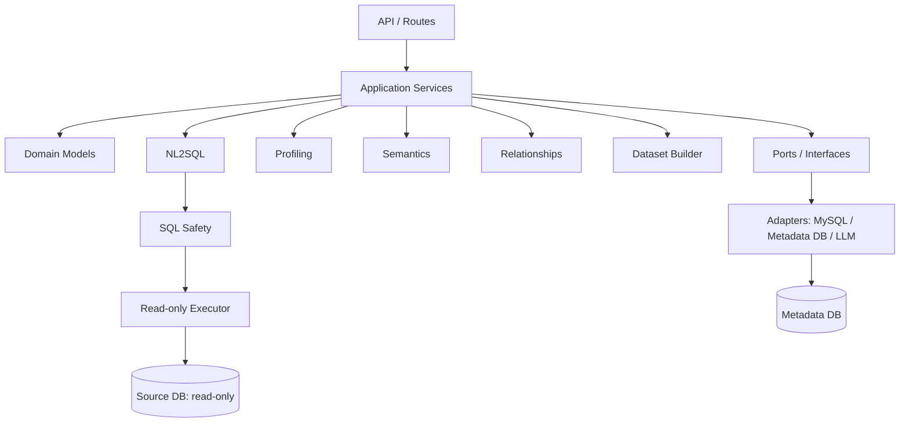

# 总体架构说明

## 1. 选择：模块化单体

一个 FastAPI 服务，内部按领域拆模块。当前处于技术验证阶段，模块化单体便于本地运行、测试和让 Claude Code 分期实现。只有当扫描任务、查询执行或团队边界确实需要独立扩缩容时，再拆服务。

## 2. 分层与依赖方向

- `api` 只负责 HTTP 参数、状态码和响应模型。
- `services` 编排一个完整用例，不直接拼大量 SQL 或调用某家模型 SDK。
- `domain` 放跨阶段共享对象，避免每个阶段重复造不同格式。
- `ports` 定义接口；`adapters` 提供具体实现。替换数据库或模型供应商时尽量不改业务模块。
- `profiling / semantics / relationships / datasets / nl2sql / agents` 各自负责独立能力。

## 3. 关键数据流

1. M1：Connector 读取源数据库元数据，Profiler 生成画像，Repository 保存快照。
2. M2：字段理解模块把元数据/画像转成字段语义候选。
3. M3：关系发现模块召回候选、计算证据、执行受限验证；候选关系不自动视为真实关系。
4. M4：语义模型构建器组织实体、属性、关系、指标和粒度。
5. M5：数据集构建器生成 SQL 预览，校验粒度和指标后再发布视图/宽表；宽表可导出到 Elasticsearch。
6. M6：NL2SQL 从语义层检索相关上下文，生成 SQL，经 AST 安全检查后只读执行。
7. M7：智能体以受控工作流调用已有能力，不绕过安全层。
8. M8：补齐权限、审计、漂移检测、部署和恢复。

## 4. 解耦规则

- 新增数据库：实现 `DataSourceConnector`，不改关系算法。
- 更换模型供应商：实现 `LLMClient` / `EmbeddingClient`，不改语义业务逻辑。
- 更换元数据存储：实现 `MetadataRepository`，不改领域模型。
- 关系算法升级：替换 `RelationshipDiscoveryService` 内部策略，维持输入输出契约。
- 新增阶段能力：通过明确的 domain/port/service 接口连接，避免跨模块直接访问私有变量。

## 5. 复杂度边界

第一版不默认引入微服务、Kafka/Flink、图数据库、复杂工作流框架或多智能体系统。关系图可以先用关系记录和邻接查询实现；数据集先生成 SQL 视图。需要时再扩展，不提前为未知需求搭基础设施。

## 6. 安全底线

源库使用只读账号；密钥不进日志；样本最小化并脱敏；模型输出视为不可信；SQL 执行前做 AST 检查；查询有超时和行数预算；未通过质量校验的数据集不得发布。

## 7. 环境与外部服务配置

运行环境以现有 Conda `nl2sql` / Python 3.13.18 为准。配置统一由 `app/core/config.py`
读取根目录 `.env`，进程环境变量可覆盖。详见 [配置说明](configuration.md)。
`BIZ_MYSQL_*` 用于系统业务库，`DATA_MYSQL_*` 用于只读查询数据源，SQLite 默认用于系统元数据，Elasticsearch 用于检索索引与后续宽表存储，
DeepSeek 通过 `LLMClient` 接入。当前仅完成配置加载，外部服务适配器和自动装配仍待实现。
ES 写入不改变源 MySQL 的只读约束；SQL 查询路径与后续 ES 查询路径需要分别适配。
登录/JWT 配置已加载，登录、鉴权及系统业务库持久化尚未实现。
